# AVANT GARDE COUTURE CIRCUITRY
### Maison Avant-Garde — Where Haute Couture Meets Electrical Engineering

<p align="center">

  **L'ART DE LA MODE ET DE L'INGÉNIERIE**

  *A futuristic Parisian fashion house where couture craftsmanship, electrical engineering, wearable electronics, and avant-garde creativity become one interactive experience.*

</p>

<p align="center">

  
  
  
  

</p>

---

# TABLE OF CONTENTS

1. [Project Overview](#1-project-overview)
2. [The Vision: Maison Avant-Garde](#2-the-vision-maison-avant-garde)
3. [The Problem](#3-the-problem)
4. [The Solution](#4-the-solution)
5. [Core Product Experience](#5-core-product-experience)
6. [System Architecture](#6-system-architecture)
7. [Technology Stack](#7-technology-stack)
8. [Application Navigation and Modules](#8-application-navigation-and-modules)
9. [The Haute Couture Atelier](#9-the-haute-couture-atelier)
10. [Advanced Dress Design System](#10-advanced-dress-design-system)
11. [Textile and Material Intelligence](#11-textile-and-material-intelligence)
12. [Wearable Electronics Laboratory](#12-wearable-electronics-laboratory)
13. [LED Circuit Analysis Engine](#13-led-circuit-analysis-engine)
14. [Circuit Visualization and Diagnostics](#14-circuit-visualization-and-diagnostics)
15. [Garment and Electronics Integration](#15-garment-and-electronics-integration)
16. [Fashion Collections and Runway](#16-fashion-collections-and-runway)
17. [Fashion House Management and Progression](#17-fashion-house-management-and-progression)
18. [Data Architecture and Mock Datasets](#18-data-architecture-and-mock-datasets)
19. [User Experience, Animation and Accessibility](#19-user-experience-animation-and-accessibility)
20. [Testing, Deployment, Roadmap and Future Research](#20-testing-deployment-roadmap-and-future-research)

---

# 1. PROJECT OVERVIEW

## 1.1 Introduction

**AVANT GARDE COUTURE CIRCUITRY** is an interactive fashion-technology platform that combines digital haute couture design with electrical engineering education.

The application imagines a new kind of Parisian fashion house: one where designers do not simply create garments, but engineer intelligent wearable creations.

Users enter the fictional world of **Maison Avant-Garde**, an experimental fashion house dedicated to exploring the intersection of:

- Haute couture.
- Fashion illustration.
- Textile design.
- Electrical engineering.
- LED lighting systems.
- Conductive materials.
- Wearable electronics.
- Interactive garment design.
- Creative technology.
- Digital fashion presentation.

The platform provides an end-to-end creative experience.

A user can select a dress silhouette, customize its bodice and skirt, choose fabrics, add embroidery, position electronic components, design LED lighting zones, construct circuits, analyze electrical behavior, and present the completed garment on a virtual runway.

The project makes electrical engineering part of the fashion-design process.

## 1.2 Product Identity

| Attribute | Description |
|---|---|
| Product name | AVANT GARDE COUTURE CIRCUITRY |
| Brand identity | Maison Avant-Garde |
| Product category | Fashion technology and interactive education |
| Primary experience | Digital haute couture and electronics design |
| Creative environment | Parisian experimental fashion house |
| Technical environment | Wearable electronics laboratory |
| Primary tagline | L'Art de la Mode et de l'Ingénierie |
| Core concept | Where fashion becomes intelligent |

## 1.3 Product Philosophy

Traditional fashion design focuses on silhouette, materials, color, construction, and presentation.

Traditional electronics design focuses on circuits, components, voltage, current, resistance, and power.

AVANT GARDE COUTURE CIRCUITRY brings these disciplines together.

A dress is no longer simply a visual object. It can become a designed electronic system with:

- Illuminated textile patterns.
- Programmable LED zones.
- Conductive thread pathways.
- Integrated power sources.
- Electronic accessories.
- Interactive lighting effects.
- Engineered garment details.

The result is a creative platform in which aesthetic decisions and technical decisions influence one another.

## 1.4 Core Product Loop

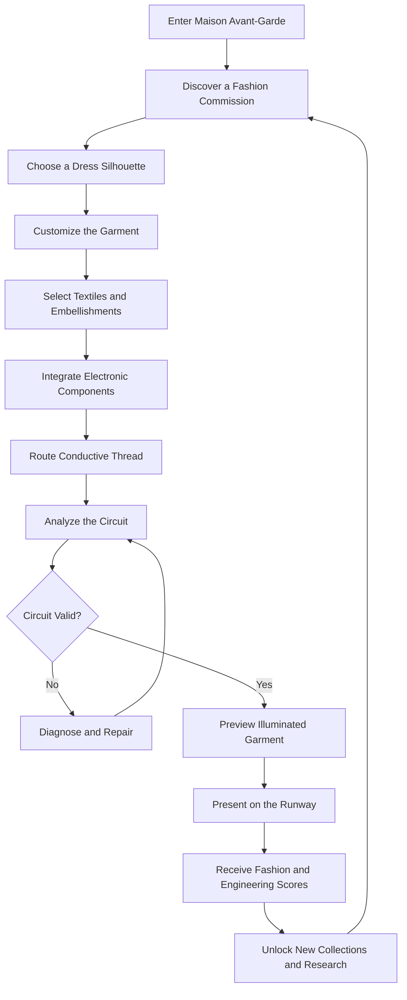

## 1.5 Design Objectives

The completed product is built around five primary objectives.

**Creative freedom:** Enable users to experiment with original garment silhouettes, materials, embellishments, and lighting.

**Technical understanding:** Make electrical engineering concepts accessible through visual interactions.

**Fashion quality:** Establish an elegant, coherent haute couture design environment.

**Interactive learning:** Turn circuit construction and troubleshooting into meaningful creative challenges.

**Progression:** Give users a reason to continue building their fashion house and developing increasingly sophisticated designs.

---

# 2. THE VISION: MAISON AVANT-GARDE

## 2.1 A Fictional Parisian Fashion House

Maison Avant-Garde is the fictional creative institution behind the application.

It is imagined as an experimental Parisian atelier that explores the future of fashion.

Its philosophy is:

*La beauté de la création. L'audace de l'innovation.*

The beauty of creation. The audacity of innovation.

The fashion house has several departments.

| Department | Purpose |
|---|---|
| Le Salon | Main dashboard and welcome experience |
| L'Histoire | Story and character progression |
| L'Atelier | Garment design and customization |
| Le Laboratoire | Electronics and circuit engineering |
| Les Collections | Garment collections and design library |
| Le Défilé | Virtual runway presentations |
| La Maison | Fashion-house management |
| Distinctions | Achievements and milestones |

## 2.2 French Fashion-House Identity

The application uses French terminology to reinforce its creative identity.

| French | English |
|---|---|
| Maison | Fashion house |
| Atelier | Design studio |
| Couture | Dressmaking and garment creation |
| Haute couture | High-fashion craftsmanship |
| Le Défilé | Fashion runway |
| Collection | Collection |
| Silhouette | Silhouette |
| Tissu | Fabric |
| Broderie | Embroidery |
| Finitions | Finishing details |
| Accessoires | Accessories |
| Recherche | Research |
| Innovation | Innovation |
| Réputation | Reputation |
| Prestige | Prestige |

French terminology is used for atmosphere and identity while technical explanations remain accessible.

## 2.3 Brand Design System

The visual identity combines Parisian luxury with futuristic engineering.

### Primary palette

| Color | Hex | Usage |
|---|---|---|
| Porcelain Ivory | `#FAF7F1` | Main background |
| Champagne | `#E6D2B4` | Luxury accents |
| Antique Gold | `#B99A67` | Decorative details |
| Burgundy | `#651E36` | Primary brand color |
| Midnight Black | `#19171A` | Runway and contrast |
| Dusty Rose | `#D6A4AD` | Fashion accents |
| Parisian Grey | `#C8C3BE` | Secondary surfaces |
| Electric Cyan | `#55D9E8` | Electronics |
| Lavender | `#C7B8E7` | Creative accents |

### Typography

- Cormorant Garamond: editorial fashion headlines.
- DM Sans: interface typography.
- JetBrains Mono: circuit data, calculations, and technical measurements.

## 2.4 Visual Design Philosophy

The application intentionally separates the visual identity of the fashion and engineering environments.

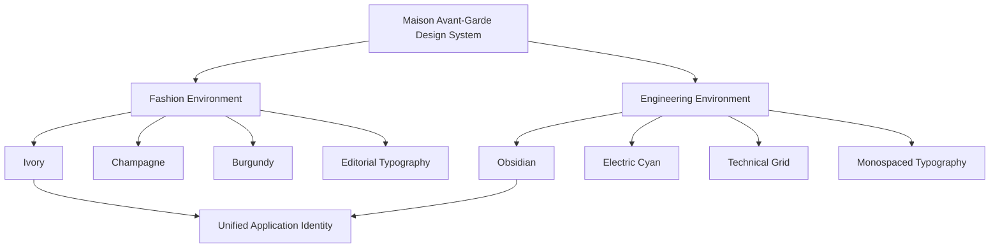

The Atelier should feel warm, artistic, and luxurious.

The Laboratoire should feel technical, precise, and futuristic.

The Défilé should feel cinematic.

---

# 3. THE PROBLEM

## 3.1 Fashion and Engineering Are Often Separated

Fashion-design applications typically prioritize:

- Visual appearance.
- Silhouette.
- Fabric.
- Color.
- Accessories.
- Styling.
- Presentation.

Engineering applications typically prioritize:

- Circuit diagrams.
- Components.
- Voltage.
- Current.
- Resistance.
- Power.
- Electrical analysis.

These environments rarely offer a unified creative workflow.

A fashion designer interested in wearable technology may need to switch between multiple tools to understand how an electronic system can be integrated into a garment.

An engineering student may understand how an LED circuit works but have limited opportunities to explore its visual and creative applications.

## 3.2 The Wearable Electronics Challenge

Integrating electronics into clothing introduces additional design considerations.

Examples include:

- Where should the battery be positioned?
- How should conductive thread be routed?
- How many LEDs can a circuit support?
- What resistor is required?
- How should lighting zones be separated?
- How does garment construction affect component placement?
- How can electronic components remain visually integrated?
- How can an electrical problem be diagnosed?

These are both engineering and design questions.

## 3.3 The Educational Opportunity

The application creates an interactive environment where users can discover these relationships.

For example, a user designing an illuminated evening gown must think about:

1. Garment silhouette.
2. LED placement.
3. Electrical topology.
4. Resistor selection.
5. Power requirements.
6. Conductive textile resistance.
7. Lighting presentation.

This creates a practical connection between abstract electrical concepts and visible creative outcomes.

---

# 4. THE SOLUTION

## 4.1 An Integrated Fashion-Engineering Platform

AVANT GARDE COUTURE CIRCUITRY brings the creative and technical workflows into one application.

It provides a shared design environment.

The garment is the central product object.

Its appearance, materials, components, and electronic systems are connected.

## 4.2 Unified Workflow

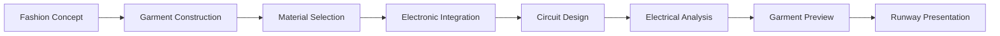

## 4.3 Two Complementary Design Dimensions

The application evaluates the garment using two separate dimensions.

### Fashion dimension

- Silhouette.
- Fabric.
- Color harmony.
- Embroidery.
- Construction.
- Originality.
- Presentation.

### Engineering dimension

- Circuit validity.
- LED operation.
- Current requirements.
- Resistor selection.
- Power consumption.
- Component compatibility.
- Circuit efficiency.

A garment can be aesthetically successful without being electrically valid, and an electrically valid garment can still require further fashion refinement.

The platform preserves this distinction.

## 4.4 Design Principles

1. Fashion and engineering must remain connected.
2. Visual quality must not compromise technical accuracy.
3. Every important interactive control must have a purpose.
4. Engineering results must come from calculations.
5. Garment customization must be persistent within the design state.
6. The runway must reflect the actual garment configuration.
7. Learning should emerge naturally through experimentation.

---

# 5. CORE PRODUCT EXPERIENCE

## 5.1 User Journey

The user enters Maison Avant-Garde and discovers the current fashion-house commissions.

They select a design challenge and enter L'Atelier.

Inside the Atelier, the user selects a garment silhouette and begins customizing the dress.

The garment can be modified through several layers:

- Bodice.
- Skirt.
- Sleeves.
- Neckline.
- Fabric.
- Color.
- Embroidery.
- Accessories.
- Lighting elements.

The user then enters Le Laboratoire to build the electrical system.

After the circuit is analyzed, the user returns to the garment preview and sees its electronic features.

Finally, the completed garment is presented on Le Défilé.

## 5.2 Main Application Experience

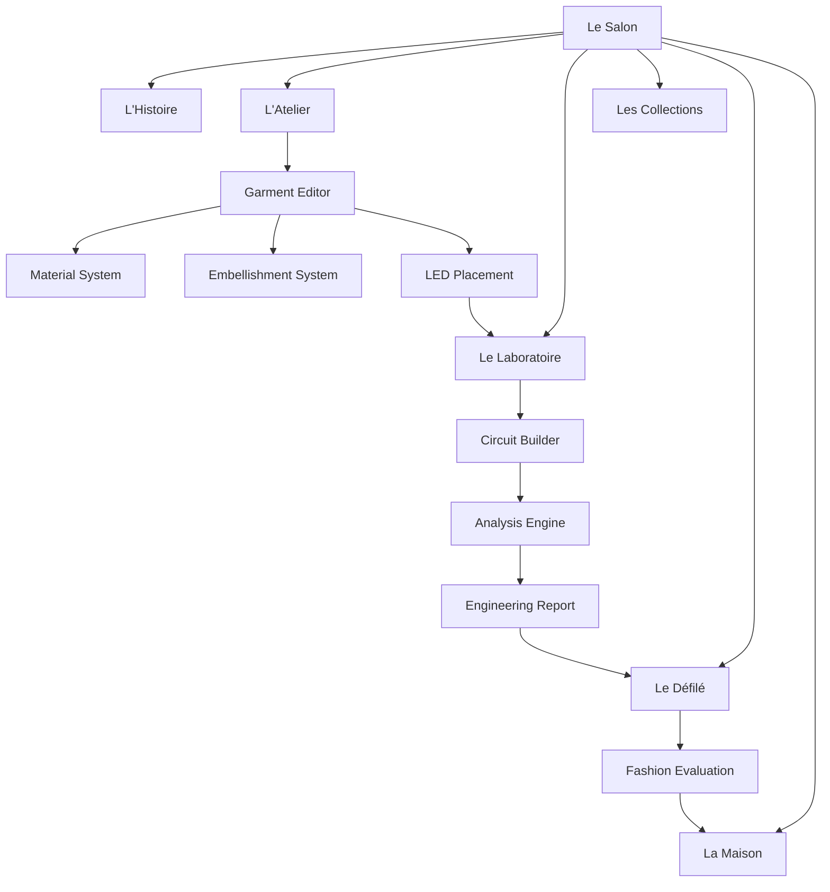

## 5.3 Example User Scenario

A user receives a commission:

**L'ÉTOILE ROYALE**

Objective:

Create a champagne-gold evening gown with illuminated star patterns.

Required design elements:

- Structured bodice.
- Voluminous skirt.
- Pearl embroidery.
- Twelve miniature LEDs.
- Three independent lighting zones.

The user designs the garment, positions the LEDs, creates the circuit, and checks the electrical calculations.

After validation, the garment is presented with a coordinated lighting sequence.

The mission evaluates both the visual design and the electrical implementation.

---

# 6. SYSTEM ARCHITECTURE

## 6.1 High-Level Architecture

The application follows a modular frontend architecture.

The presentation layer manages the user interface.

The application layer manages user workflows and shared state.

The domain layer contains garment, material, circuit, mission, and progression logic.

The data layer manages mock datasets and persistence adapters.

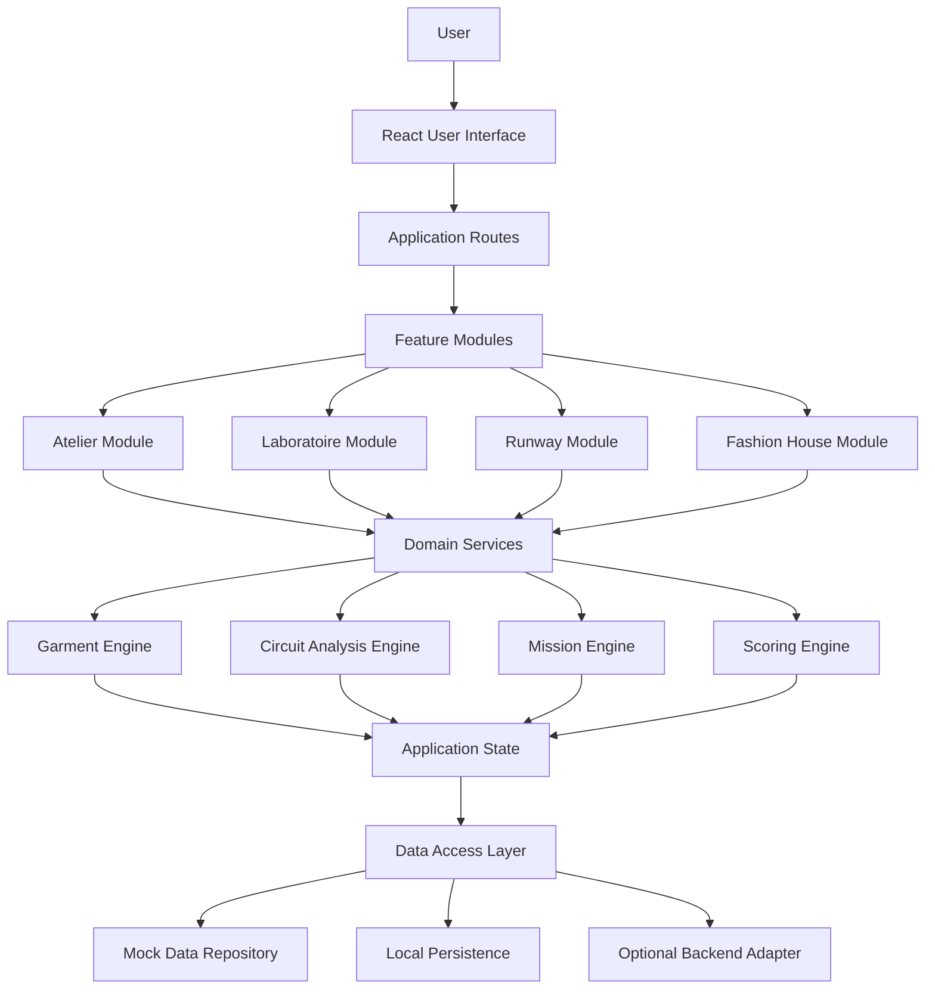

## 6.2 Architectural Goals

- Clear separation of interface and domain logic.
- Reusable React components.
- Strong TypeScript contracts.
- Centralized application state.
- Deterministic circuit analysis.
- Consistent garment rendering.
- Modular data access.
- Testable business rules.
- Backend independence for the core demo.

## 6.3 Feature Module Boundaries

| Module | Responsibilities |
|---|---|
| Dashboard | Navigation, activity, progress |
| Story | Narrative and character interactions |
| Atelier | Garment editing |
| Materials | Textile selection and properties |
| Embellishments | Decorative garment details |
| Laboratoire | Circuit construction |
| Circuit Engine | Electrical calculations |
| Runway | Garment presentation |
| Fashion House | Progression and economy |
| Achievements | Milestones and rewards |

## 6.4 Shared Source of Truth

The garment and circuit must not become disconnected representations.

A single design project contains the garment configuration and its associated electrical configuration.

Changes to component placement should update the corresponding circuit references.

Changes to circuit state should update the lighting preview.

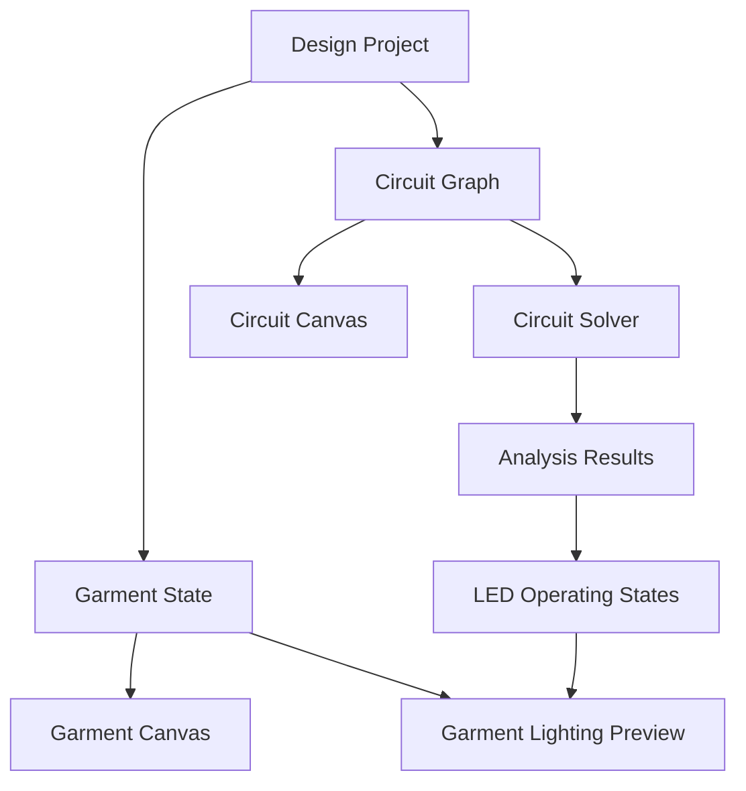

This architecture avoids separate, conflicting versions of the same garment.

---

# 7. TECHNOLOGY STACK

## 7.1 Frontend

The application uses a modern React-based web architecture.

| Technology | Responsibility |
|---|---|
| React | Component-based interface |
| TypeScript | Type safety |
| Tailwind CSS | Utility-first styling |
| shadcn/ui | Reusable interface primitives |
| Framer Motion | Animations and transitions |
| SVG | Garment and circuit visualization |
| Zustand or equivalent | Application state management |
| Zod | Runtime schema validation |

The exact implementation should remain aligned with the existing project configuration.

## 7.2 Frontend Architecture

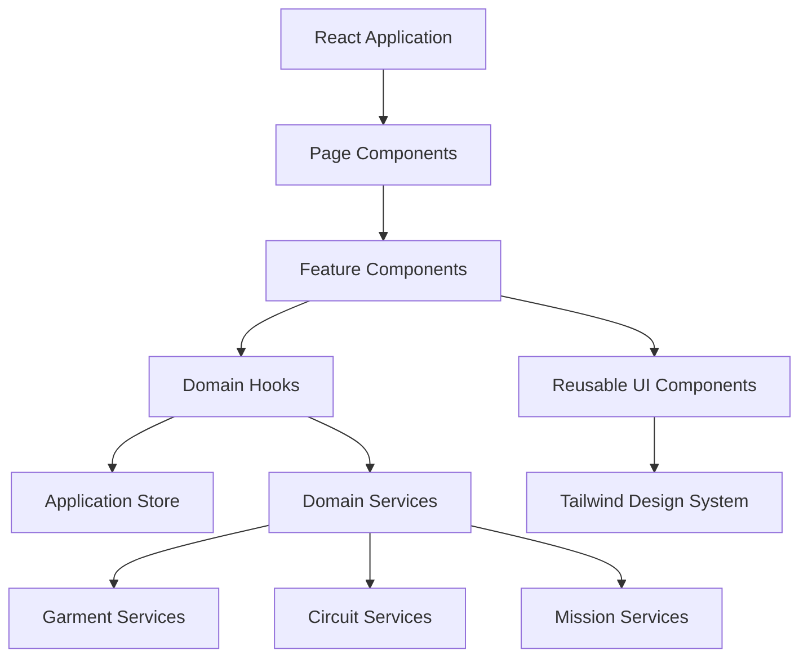

## 7.3 Supporting Technologies

Potential supporting libraries include:

- React Router for navigation.
- Lucide React for icons.
- Vitest for unit testing.
- React Testing Library for component testing.
- Playwright for end-to-end testing.
- Supabase for optional authentication and persistence.
- PostgreSQL for structured persistent records.

These are architectural integrations; the application should use the dependencies actually present in its repository.

## 7.4 Development Environment

Typical commands for a Vite-based React project:

```bash
npm install
npm run dev
```

Build:

```bash
npm run build
```

Tests:

```bash
npm run test
```

Lint:

```bash
npm run lint
```

The exact scripts are defined in `package.json`.

---

# 8. APPLICATION NAVIGATION AND MODULES

## 8.1 Le Salon

The main dashboard introduces the fashion house.

It provides:

- Featured missions.
- Current collection.
- Design progress.
- Engineering progress.
- Currency and prestige.
- Recent activity.
- Available commissions.

## 8.2 L'Histoire

The narrative environment introduces the fictional fashion-house universe.

Character interactions and missions provide context for design challenges.

The story experience can include:

- Dialogue.
- Character portraits.
- Scene transitions.
- Mission objectives.
- Narrative decisions.

## 8.3 L'Atelier

The primary garment-design environment.

It manages:

- Silhouettes.
- Dress construction.
- Fabric.
- Color.
- Accessories.
- Embroidery.
- Layering.
- LED placement.

## 8.4 Le Laboratoire

The engineering environment.

It manages:

- Electronic components.
- Circuit construction.
- Circuit topology.
- LED configuration.
- Resistor calculations.
- Battery models.
- Conductive thread.
- Fault detection.
- Engineering reports.

## 8.5 Les Collections

The garment gallery.

Users can discover and manage:

- Original designs.
- Seasonal collections.
- Illuminated couture.
- Experimental garments.
- Saved creations.

## 8.6 Le Défilé

The presentation environment.

It displays the finished garment and its electronic behavior.

## 8.7 La Maison

The fashion-house progression system.

It manages:

- Reputation.
- Prestige.
- Research.
- Materials.
- Employees.
- Studio upgrades.
- Sponsorships.
- Commissions.

---

# 9. THE HAUTE COUTURE ATELIER

## 9.1 Overview

L'Atelier is the main creative workspace.

It is designed to resemble a futuristic couture design studio.

Its visual identity combines warm ivory surfaces, burgundy accents, champagne details, and editorial typography.

The garment is the focal point.

## 9.2 Workspace Layout

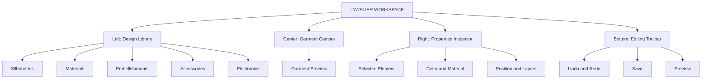

## 9.3 Design Canvas

The garment canvas supports:

- Garment selection.
- Component selection.
- Fabric changes.
- Color changes.
- Decoration placement.
- LED placement.
- Layer ordering.
- Zoom.
- Pan.
- Object positioning.

The canvas uses a consistent coordinate system.

Every garment element is represented as a structured object.

## 9.4 Design Operations

Common design operations include:

| Operation | Description |
|---|---|
| Select | Select a garment or element |
| Add | Insert a component |
| Move | Change position |
| Rotate | Change orientation |
| Resize | Adjust dimensions |
| Remove | Delete an element |
| Layer | Change drawing order |
| Duplicate | Create a copy |
| Undo | Reverse an operation |
| Redo | Restore an operation |

## 9.5 Design State

The garment editor stores a structured design configuration.

A garment is not merely a static image.

It is a collection of independently configurable design elements.

---

# 10. ADVANCED DRESS DESIGN SYSTEM

## 10.1 Silhouette Library

The fashion engine supports a broad collection of dress silhouettes.

Representative categories include:

- Ball gowns.
- Mermaid gowns.
- A-line dresses.
- Column dresses.
- Architectural gowns.
- Asymmetrical gowns.
- Sculptural dresses.
- Romantic gowns.
- Futuristic gowns.
- Minimalist eveningwear.
- Experimental couture.

Each silhouette has its own construction configuration and visual representation.

## 10.2 Original Couture Designs

Representative garments include:

| Garment | Design concept |
|---|---|
| L'Étoile Royale | Champagne-gold illuminated ball gown |
| Rose Impériale | Romantic floral couture |
| La Reine de Minuit | Dramatic midnight gown |
| Ciel de Champagne | Pearl and organza eveningwear |
| Neon Étoile | Futuristic illuminated gown |
| Aurora 2099 | Iridescent programmable couture |
| Jardin de Roses | Floral appliqué dress |
| Origami de Luxe | Architectural folded textile |
| Lumière Noire | Black velvet illuminated gown |
| Crystal Structure | Geometric transparent couture |

## 10.3 Garment Construction

A dress is assembled from multiple components.

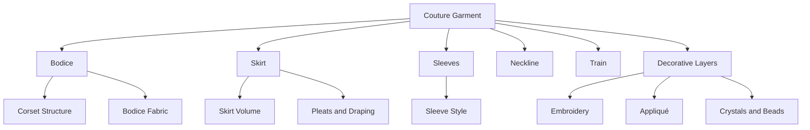

## 10.4 Customization Controls

The user can customize:

- Silhouette.
- Bodice.
- Skirt.
- Sleeve.
- Neckline.
- Train.
- Fabric.
- Color.
- Texture.
- Embroidery.
- Accessories.
- Lighting details.

## 10.5 Layered Rendering

The garment renderer combines visual layers.

Suggested rendering order:

1. Base silhouette.
2. Garment lining.
3. Main textile.
4. Secondary textile.
5. Bodice details.
6. Skirt details.
7. Transparent overlays.
8. Embroidery.
9. Decorative elements.
10. Electronic components.
11. Lighting effects.
12. Final highlights.

This creates a more dimensional garment preview than a single flat shape.

## 10.6 Garment Data Model

```typescript
type CoutureGarment = {
  id: string;
  name: string;
  collectionId: string;

  silhouette: {
    type: string;
    skirtType: string;
    bodiceType: string;
    neckline: string;
    sleeveTypes: string[];
    trainType?: string;
  };

  materials: {
    primary: string;
    secondary: string[];
    lining?: string;
  };

  colors: {
    bodice: string;
    skirt: string;
    trim: string;
    embroidery: string;
  };

  embellishments: {
    id: string;
    type: string;
    position: {
      x: number;
      y: number;
    };
    scale: number;
    rotation: number;
  }[];

  electronics: {
    enabled: boolean;
    componentIds: string[];
    lightingZoneIds: string[];
  };

  version: number;
  updatedAt: string;
};
```

---

# 11. TEXTILE AND MATERIAL INTELLIGENCE

## 11.1 Material Library

The material library supports both visual and technical textile characteristics.

Representative materials:

- Silk satin.
- Duchesse satin.
- Velvet.
- Organza.
- Chiffon.
- Tulle.
- Lace.
- Brocade.
- Metallic textile.
- Reflective textile.
- Conductive fabric.
- Technical mesh.
- Cotton.
- Embroidered fabric.

## 11.2 Material Properties

Each material can define:

- Weight.
- Texture.
- Transparency.
- Reflectivity.
- Stretch.
- Drape category.
- Visual appearance.
- Conductivity where applicable.
- Compatibility tags.

## 11.3 Textile Data Model

```typescript
type TextileMaterial = {
  id: string;
  name: string;
  category: string;

  visual: {
    textureAsset?: string;
    baseColor: string;
    transparency: number;
    reflectivity: number;
  };

  physical: {
    weightGsm?: number;
    stretchPercent?: number;
    drapeCategory?: string;
  };

  electrical?: {
    resistanceOhmsPerMeter?: number;
    conductive: boolean;
  };

  tags: string[];
};
```

## 11.4 Textile and Electronics Integration

Textiles may influence the electronic design.

For example:

- Conductive thread contributes resistance.
- Route length affects voltage drop.
- Stretch may affect a simplified resistance estimate.
- Material placement influences component layout.
- Fabric thickness may affect the visual integration of electronics.

The application distinguishes between illustrative game estimates and validated material engineering data.

---

# 12. WEARABLE ELECTRONICS LABORATORY

## 12.1 Le Laboratoire

Le Laboratoire is the engineering department of Maison Avant-Garde.

Its purpose is to make electronic garment construction understandable through visual interaction.

It provides a workspace for selecting components, connecting circuits, analyzing electrical behavior, and diagnosing faults.

## 12.2 Component Library

Component categories include:

| Category | Components |
|---|---|
| Light | LEDs, RGB LEDs, addressable LEDs |
| Resistance | Fixed resistors |
| Power | Batteries and power supplies |
| Switching | Switches and control elements |
| Conductive textiles | Conductive thread and fabric |
| Control | Microcontrollers |
| Sensors | Input sensors |
| Connections | Wires and connectors |

## 12.3 Component Data Model

```typescript
type ElectronicComponent = {
  id: string;
  name: string;

  type:
    | "led"
    | "resistor"
    | "battery"
    | "switch"
    | "sensor"
    | "microcontroller"
    | "wire";

  electrical: {
    voltage?: number;
    forwardVoltage?: number;
    current?: number;
    maximumCurrent?: number;
    resistance?: number;
    powerRating?: number;
  };

  visual: {
    symbol: string;
    color?: string;
    icon?: string;
  };

  garmentPlacement?: {
    x: number;
    y: number;
    region: string;
  };
};
```

## 12.4 Circuit Construction

The circuit editor supports:

- Component placement.
- Component selection.
- Connection creation.
- Wire routing.
- Node identification.
- Component deletion.
- Grid snapping.
- Zoom and pan.
- Circuit validation.

The circuit graph is the authoritative source for analysis.

## 12.5 Circuit Representation

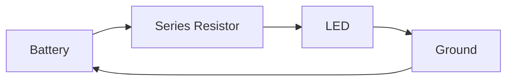

This represents a basic series LED circuit.

The electrical model is evaluated independently from its visual rendering.

---

# 13. LED CIRCUIT ANALYSIS ENGINE

## 13.1 Overview

The LED analysis engine evaluates electrical configurations used in illuminated garments.

It provides calculations for:

- Resistor selection.
- LED current.
- Voltage drop.
- Resistor power.
- Series circuits.
- Parallel branches.
- Battery capacity estimates.
- Conductive thread resistance.
- Basic circuit fault detection.

The solver should use the circuit graph rather than hardcoded results.

## 13.2 Ohm's Law

Ohm's law is:

\[
V = I R
\]

Where:

- \(V\) is voltage in volts.
- \(I\) is current in amperes.
- \(R\) is resistance in ohms.

Rearranged:

\[
I = \frac{V}{R}
\]

\[
R = \frac{V}{I}
\]

## 13.3 LED Series Resistor

For a simple LED circuit:

\[
R = \frac{V_s - V_f}{I}
\]

Where:

- \(V_s\) is supply voltage.
- \(V_f\) is LED forward voltage.
- \(I\) is target LED current.

Example:

| Parameter | Value |
|---|---:|
| Supply voltage | 5 V |
| LED forward voltage | 2 V |
| Target current | 0.010 A |

\[
R = \frac{5-2}{0.010}
\]

\[
R = 300\ \Omega
\]

A practical implementation may select a standard resistor value and then recalculate the actual operating current.

The chosen resistor must also satisfy the relevant component ratings.

## 13.4 Resistor Power Dissipation

Resistor power:

\[
P = I^2 R
\]

Alternatively:

\[
P = VI
\]

For the example:

\[
P = (0.010)^2 \times 300
\]

\[
P = 0.03\ W
\]

The application can compare calculated power with the resistor's rated power.

## 13.5 Series Circuits

In a series circuit, the same current flows through each component.

\[
R_{total} = R_1 + R_2 + \cdots + R_n
\]

The total voltage is distributed across the components.

## 13.6 Parallel Circuits

For resistors in parallel:

\[
\frac{1}{R_{total}} =
\frac{1}{R_1} +
\frac{1}{R_2} + \cdots +
\frac{1}{R_n}
\]

LED branches must be evaluated individually.

Each parallel LED branch may require its own current-limiting resistor.

The application must not incorrectly apply the resistor-equivalent formula to arbitrary LED networks.

## 13.7 Kirchhoff's Laws

Kirchhoff's Current Law:

\[
\sum I_{in} = \sum I_{out}
\]

Kirchhoff's Voltage Law:

\[
\sum V = 0
\]

These principles support circuit validation and network analysis.

## 13.8 Conductive Thread Resistance

A simplified conductive-thread model:

\[
R_{thread} = rL
\]

Where:

- \(r\) is resistance per meter.
- \(L\) is route length.

Voltage drop:

\[
V_{drop} = I R_{thread}
\]

A more advanced model may account for changes in resistance caused by stretching, connection quality, and material behavior.

These values should be identified as estimates unless supported by measured textile data.

## 13.9 Battery Runtime

A simplified battery runtime estimate:

\[
t = \frac{C_{Ah}}{I_A}
\]

Where:

- \(C_{Ah}\) is usable battery capacity.
- \(I_A\) is average current.

An efficiency and usable-capacity factor can improve the estimate.

This is an educational approximation, not a certified battery-life prediction.

## 13.10 Circuit Solver Workflow

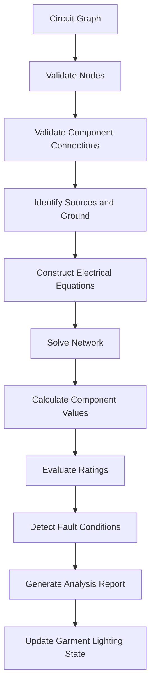

## 13.11 Fault Detection

Supported diagnostic categories include:

- Open connection.
- Short circuit.
- Reversed LED polarity.
- Missing resistor.
- Excessive current.
- Excessive resistor power.
- Insufficient supply voltage.
- Unsupported circuit topology.
- Invalid component configuration.

The application must explain why a fault is detected.

Unsupported or mathematically singular networks must produce a clear diagnostic rather than fabricated results.

---

# 14. CIRCUIT VISUALIZATION AND DIAGNOSTICS

## 14.1 Circuit Canvas

The circuit canvas visualizes the actual circuit graph.

It supports:

- Nodes.
- Components.
- Connections.
- Labels.
- Electrical paths.
- Selection.
- Status indicators.

## 14.2 Electrical Visualization Modes

The user can switch between:

1. Standard circuit view.
2. Voltage view.
3. Current view.
4. Component status.
5. Fault diagnostic view.

## 14.3 LED Visualization

LED states are derived from the solver.

Possible states:

| State | Visual behavior |
|---|---|
| Disconnected | LED off |
| Reverse-biased | Warning state |
| Valid operation | Illuminated |
| Excessive current | Warning |
| Invalid circuit | Fault indicator |
| Analysis unavailable | Neutral status |

## 14.4 Animated Analysis

When the user starts analysis:

1. Circuit graph is inspected.
2. Connections are validated.
3. The power source is identified.
4. Electrical equations are evaluated.
5. Component values are calculated.
6. Faults are checked.
7. The report is generated.

Animations reflect the progress of actual computations.

## 14.5 Engineering Report

The report includes:

- Circuit status.
- Component inventory.
- Supply voltage.
- Branch currents.
- Voltage drops.
- LED status.
- Resistor values.
- Power dissipation.
- Faults.
- Recommendations.

The report is generated from the current analysis state.

---

# 15. GARMENT AND ELECTRONICS INTEGRATION

## 15.1 The Intelligent Garment

The central product innovation is the integration of the garment and its electronic configuration.

A garment contains both a visual design and a technical design.

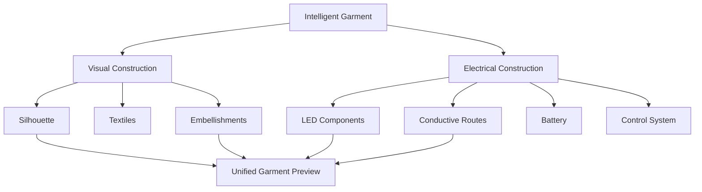

## 15.2 Lighting Zones

A garment may contain independent lighting zones.

Example:

**L'ÉTOILE ROYALE**

| Zone | Placement | Function |
|---|---|---|
| Zone 1 | Bodice | Central illumination |
| Zone 2 | Waist | Decorative lighting |
| Zone 3 | Skirt | Star-pattern lighting |

Each zone can have its own LED configuration.

## 15.3 Conductive Thread Routing

The user can place conductive pathways on the garment.

These pathways connect electronic components.

The route model should maintain:

- Start node.
- End node.
- Route length.
- Material type.
- Resistance estimate.
- Garment region.
- Connection status.

## 15.4 Battery Placement

Battery placement is both an engineering and fashion decision.

The application can display:

- Battery location.
- Battery mass.
- Garment region.
- Estimated runtime.
- Power requirements.

Weight and comfort values should be labeled as illustrative estimates unless supported by measured data.

## 15.5 Garment Compatibility

The system can evaluate compatibility using material and component tags.

Examples:

- A conductive thread is compatible with a conductive routing path.
- An LED requires a valid electrical connection.
- A battery must support the required supply voltage and current.
- A component must fit within the selected garment region.

## 15.6 Integration Validation

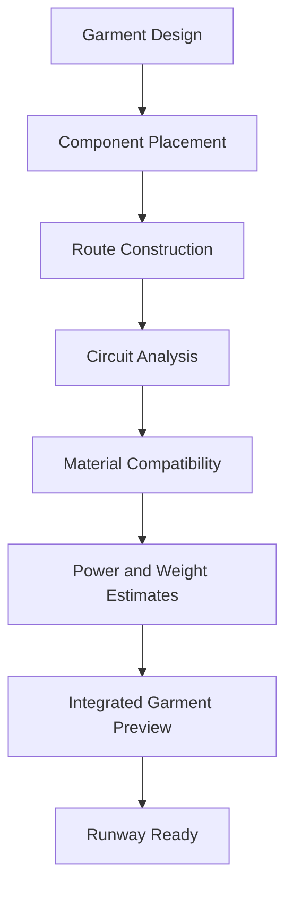

---

# 16. FASHION COLLECTIONS AND RUNWAY

## 16.1 Les Collections

The collection gallery organizes garments into themed creative releases.

Representative collections:

| Collection | Theme |
|---|---|
| Lumière de Paris | Parisian light |
| Électricité Romantique | Romantic illuminated couture |
| Jardin Électrique | Botanical electronics |
| Minuit à Paris | Midnight elegance |
| Futurisme | Experimental fashion |
| Haute Technologie | Advanced wearable electronics |

## 16.2 Collection Presentation

Each collection contains:

- Cover artwork.
- Collection description.
- Garment previews.
- Material specifications.
- Design notes.
- Technical highlights.
- Unlock status.

## 16.3 Le Défilé

The runway is the final presentation environment.

It transforms the completed garment into a cinematic fashion presentation.

The runway sequence includes:

1. Runway initialization.
2. Lighting activation.
3. Model entrance.
4. Garment reveal.
5. Lighting-zone activation.
6. Detail presentation.
7. Final collection view.
8. Score presentation.

## 16.4 Runway Architecture

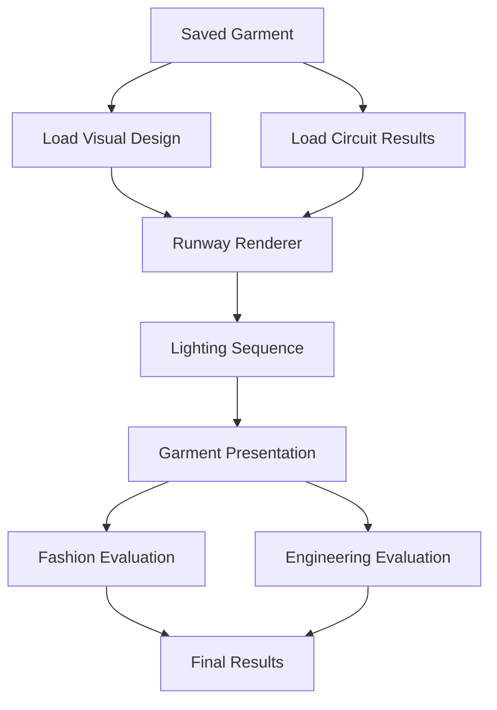

## 16.5 Independent Scoring

Fashion and engineering must be scored separately.

### Fashion evaluation

- Silhouette.
- Color harmony.
- Material selection.
- Embellishment.
- Originality.
- Presentation.

### Engineering evaluation

- Circuit validity.
- Component compatibility.
- Current requirements.
- Power dissipation.
- Lighting-zone functionality.
- Mission compliance.

An invalid circuit cannot receive a successful electrical functionality score.

## 16.6 Runway Results

The final presentation displays:

- Garment name.
- Collection.
- Designer notes.
- Fashion score.
- Engineering score.
- Completed objectives.
- Unlocked achievements.

---

# 17. FASHION HOUSE MANAGEMENT AND PROGRESSION

## 17.1 La Maison

La Maison represents the user's growing fashion business.

Users develop their own experimental couture house.

The management system includes:

- Reputation.
- Prestige.
- Credits.
- Materials.
- Research.
- Employees.
- Studio upgrades.
- Commissions.
- Sponsorships.
- Collections.

## 17.2 Progression Loop

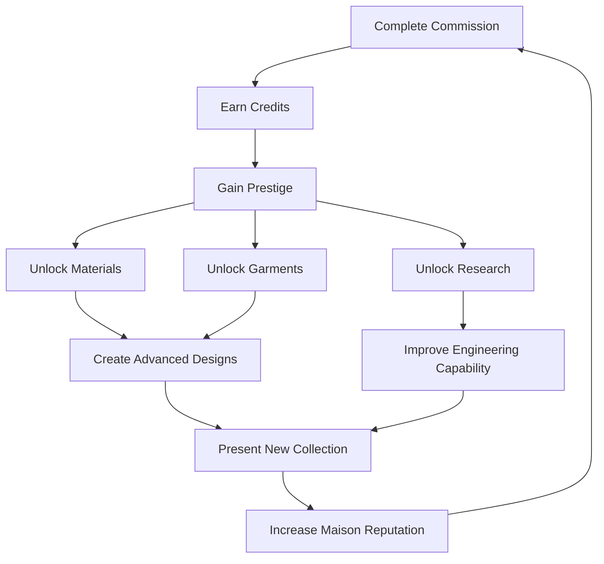

## 17.3 Research

Research categories can include:

- Advanced LED systems.
- Textile conductivity.
- Flexible electronics.
- Battery optimization.
- Circuit miniaturization.
- Intelligent textiles.
- Interactive garments.

## 17.4 Studio Upgrades

Example upgrades:

- Expanded Atelier.
- Advanced Textile Library.
- Electronics Laboratory.
- Digital Runway.
- Embroidery Workshop.
- Materials Research Department.

## 17.5 Achievements

Example achievements:

| Achievement | Requirement |
|---|---|
| Première Couture | Complete the first garment |
| Maître des Circuits | Validate a circuit |
| Lumière Créative | Create an illuminated garment |
| Reine du Défilé | Complete a runway presentation |
| Architecte de la Mode | Complete an advanced silhouette |
| Innovation Électrique | Complete an advanced engineering mission |

---

# 18. DATA ARCHITECTURE AND MOCK DATASETS

## 18.1 Data Design Philosophy

The application uses structured data models to keep its features consistent.

Core records include:

- Users.
- Fashion houses.
- Garments.
- Collections.
- Materials.
- Embellishments.
- Electronic components.
- Circuits.
- Circuit nodes.
- Connections.
- Missions.
- Achievements.
- Runway presentations.

The core product experience can operate with deterministic local mock data.

An optional backend adapter can provide persistent accounts and saved projects.

## 18.2 Entity Relationship Diagram

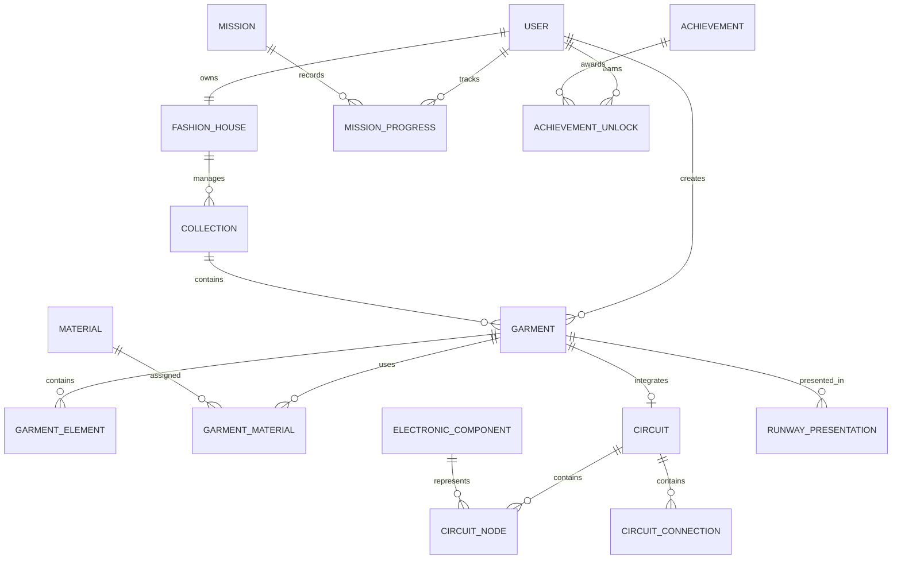

## 18.3 Garment Dataset

Example mock garment:

```json
{
  "id": "dress-001",
  "name": "L'Étoile Royale",
  "collectionId": "collection-lumiere",
  "silhouette": "ball-gown",
  "bodice": "structured-corset",
  "skirt": "voluminous-layered",
  "primaryMaterial": "champagne-organza",
  "secondaryMaterials": [
    "silk-satin",
    "pearl-tulle"
  ],
  "colors": {
    "bodice": "#E6D2B4",
    "skirt": "#FAF7F1",
    "trim": "#B99A67"
  },
  "embellishments": [
    "crystal-star",
    "pearl-embroidery"
  ],
  "electronics": {
    "enabled": true,
    "lightingZones": [
      "bodice",
      "waist",
      "skirt"
    ]
  }
}
```

## 18.4 LED Dataset

```json
[
  {
    "id": "led-warm-001",
    "name": "Warm White Micro LED",
    "type": "led",
    "forwardVoltage": 2.0,
    "recommendedCurrent": 0.01,
    "maximumCurrent": 0.02,
    "color": "#FFD9A0"
  },
  {
    "id": "led-cyan-001",
    "name": "Cyan Micro LED",
    "type": "led",
    "forwardVoltage": 3.0,
    "recommendedCurrent": 0.01,
    "maximumCurrent": 0.02,
    "color": "#55D9E8"
  },
  {
    "id": "led-rose-001",
    "name": "Rose Micro LED",
    "type": "led",
    "forwardVoltage": 2.0,
    "recommendedCurrent": 0.01,
    "maximumCurrent": 0.02,
    "color": "#D6A4AD"
  }
]
```

These are illustrative mock specifications, not manufacturer-certified ratings.

## 18.5 Mission Dataset

```json
[
  {
    "id": "mission-silent-seam",
    "name": "Silent Seam",
    "difficulty": "beginner",
    "category": "wearable-electronics",
    "objectives": [
      "Select a compatible garment",
      "Place two LEDs",
      "Create a valid circuit",
      "Run circuit analysis"
    ],
    "reward": {
      "credits": 150,
      "prestige": 20
    }
  },
  {
    "id": "mission-electric-bloom",
    "name": "Electric Bloom",
    "difficulty": "intermediate",
    "category": "illuminated-couture",
    "objectives": [
      "Create a floral garment",
      "Add three lighting zones",
      "Route conductive thread",
      "Validate the circuit",
      "Present the garment"
    ],
    "reward": {
      "credits": 350,
      "prestige": 55
    }
  }
]
```

## 18.6 Persistence Architecture

The application separates data access from UI components.

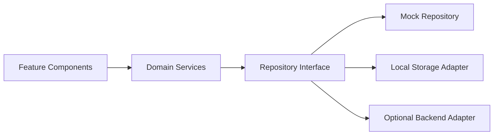

This allows the application to operate in demo mode without external credentials.

Local persistence should store user-created designs and progress where supported.

---

# 19. USER EXPERIENCE, ANIMATION AND ACCESSIBILITY

## 19.1 Design Philosophy

The application uses motion to communicate interactions.

Animations should be meaningful rather than decorative.

Examples:

- A fabric preview transitions when selected.
- A dress layer appears when added.
- A conductive path draws onto the garment.
- A powered LED illuminates.
- A completed circuit displays a success state.
- A runway presentation reveals the garment.

## 19.2 Motion System

Suggested motion durations:

| Interaction | Duration |
|---|---:|
| Button feedback | 120–180 ms |
| Card hover | 180–260 ms |
| Panel transition | 200–300 ms |
| Route transition | 250–400 ms |
| Runway presentation | 400–700 ms |

## 19.3 Responsive Design

The interface supports:

- Desktop.
- Laptop.
- Tablet.
- Mobile.

The Atelier adapts its panels into drawers on smaller screens.

The circuit canvas supports touch interaction and responsive scaling.

The runway experience adapts the presentation stage to available screen dimensions.

## 19.4 Accessibility

The application should support:

- Semantic HTML.
- Keyboard navigation.
- Visible focus indicators.
- Accessible form labels.
- Screen-reader descriptions.
- Sufficient contrast.
- Reduced-motion preferences.
- Accessible dialogs.
- Non-color-only status indicators.

## 19.5 Performance

Important optimization considerations include:

- Lazy loading garment artwork.
- Responsive image assets.
- Avoiding unnecessary component re-renders.
- Efficient SVG rendering.
- Memoizing expensive analysis operations.
- Limiting continuous decorative animations.
- Reusing cached component data.
- Cleaning up event listeners.

## 19.6 User Feedback

Every major operation should communicate its state.

Examples:

- Design saved.
- Fabric updated.
- Component placed.
- Circuit analysis complete.
- Circuit fault detected.
- Mission completed.
- Collection unlocked.

Error states must explain the problem and provide a useful next action.

---

# 20. TESTING, DEPLOYMENT, ROADMAP AND FUTURE RESEARCH

## 20.1 Testing Strategy

The application requires tests across its creative and technical modules.

### Unit tests

Test:

- Garment state updates.
- Material compatibility.
- Component properties.
- Resistor calculations.
- LED current calculations.
- Circuit topology validation.
- Power calculations.
- Mission requirements.
- Progression rewards.

### Component tests

Test:

- Navigation.
- Garment cards.
- Material selectors.
- Circuit component cards.
- Property inspectors.
- Modals.
- Runway presentation controls.

### Integration tests

Test:

- Garment editing.
- Component placement.
- Circuit creation.
- Analysis execution.
- Lighting-state synchronization.
- Mission completion.

### End-to-end tests

Test a complete workflow:

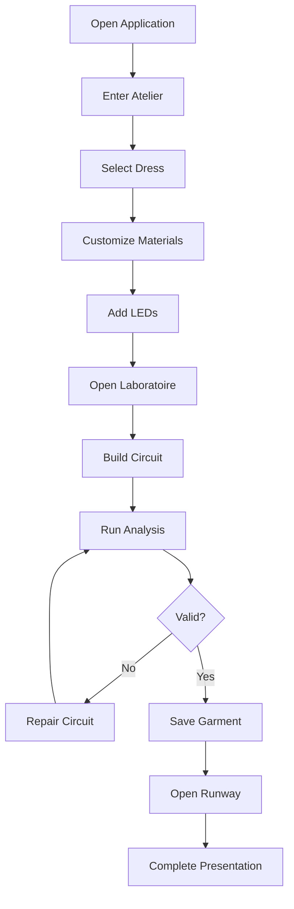

## 20.2 Example Unit Tests

```typescript
import { describe, expect, it } from "vitest";

describe("Ohm's Law", () => {
  it("calculates resistance correctly", () => {
    const supplyVoltage = 5;
    const forwardVoltage = 2;
    const current = 0.01;

    const resistance =
      (supplyVoltage - forwardVoltage) / current;

    expect(resistance).toBe(300);
  });

  it("calculates resistor power correctly", () => {
    const current = 0.01;
    const resistance = 300;

    const power = current * current * resistance;

    expect(power).toBeCloseTo(0.03);
  });
});
```

## 20.3 Quality Assurance Checklist

### Fashion

- [ ] Dress silhouettes render correctly.
- [ ] Garment customization works.
- [ ] Material changes update the preview.
- [ ] Embellishments remain positioned correctly.
- [ ] Layer ordering works.
- [ ] Saved designs remain consistent.

### Engineering

- [ ] LED polarity is represented correctly.
- [ ] Resistor calculations are correct.
- [ ] Circuit graph connections are validated.
- [ ] Branch currents are calculated correctly.
- [ ] Invalid configurations produce warnings.
- [ ] Circuit results update LED visual states.

### Integration

- [ ] Garment and circuit states remain synchronized.
- [ ] LED placement is reflected in the circuit model.
- [ ] Runway lighting uses analyzed circuit state.
- [ ] Reports use actual analysis data.

### Application

- [ ] Navigation works.
- [ ] Mobile layout works.
- [ ] No broken images.
- [ ] No dead buttons.
- [ ] No blocking console errors.
- [ ] Reduced-motion mode works.
- [ ] Local demo mode works.

## 20.4 Deployment

The application can be deployed using a compatible frontend hosting platform.

Typical deployment process:

1. Connect the repository.
2. Configure the build command.
3. Configure the output directory.
4. Set environment variables if needed.
5. Deploy.
6. Verify application routes.
7. Test mobile layouts.
8. Confirm asset loading.
9. Verify persistence configuration.

For a typical Vite application:

```bash
npm run build
```

Build output:

```text
dist/
```

The exact build and output configuration should follow the repository's existing setup.

## 20.5 Environment Variables

If an optional backend is configured, environment variables should be supplied through the deployment platform.

Example:

```env
VITE_SUPABASE_URL=
VITE_SUPABASE_ANON_KEY=
```

Never expose server-side secrets in frontend environment variables.

Do not commit `.env` files containing credentials.

## 20.6 Security and Data Integrity

The application should:

- Validate user-provided design data.
- Validate circuit graph structures.
- Avoid trusting client-side scores in a persistent backend.
- Restrict backend access using appropriate authorization.
- Protect user-owned saved designs.
- Avoid storing secrets in browser storage.
- Sanitize user-generated text where rendered.
- Validate file uploads where supported.

## 20.7 Future Development Roadmap

### Phase I — Advanced Couture Design

- More original silhouettes.
- Advanced fabric textures.
- Improved garment layering.
- Expanded embroidery library.
- Better garment previews.
- More detailed accessories.

### Phase II — Advanced Electrical Engineering

- Expanded circuit solver.
- More complex network topologies.
- Advanced LED configurations.
- PWM lighting control.
- Multi-zone control systems.
- Improved textile resistance modeling.

### Phase III — Intelligent Wearable Fashion

- Sensor-driven garments.
- Interactive textile systems.
- Microcontroller programming.
- Motion-responsive lighting.
- Sound-reactive garments.
- Environmental sensing.

### Phase IV — Advanced Garment Visualization

- Multi-view garment rendering.
- More realistic fabric behavior.
- Advanced lighting.
- Optional 3D garment visualization.
- Runway camera controls.
- Collection presentation tools.

### Phase V — Expanded Fashion House

- More characters.
- Seasonal collections.
- Advanced missions.
- Additional materials.
- Research departments.
- Expanded progression.
- New runway challenges.

## 20.8 Research Opportunities

The project provides a foundation for exploring several interdisciplinary topics.

**Smart textiles:** Conductive fabrics and textile-based electrical systems.

**Wearable electronics:** Integrating electronic components into clothing.

**Fashion engineering:** Understanding how garment construction interacts with electronic systems.

**Interactive design:** Designing garments whose appearance changes in response to electronic input.

**Educational technology:** Teaching engineering concepts through creative activities.

**Computational fashion:** Using structured data and digital tools to support garment design.

## 20.9 Important Engineering Limitations

The application's educational calculations and visualizations should not be treated as professional certification.

Real wearable electronics require additional engineering validation.

Important real-world considerations include:

- Electrical insulation.
- Battery protection.
- Thermal management.
- Moisture exposure.
- Washability.
- Mechanical durability.
- Skin contact.
- Component enclosure.
- Short-circuit protection.
- Regulatory compliance.

A simplified textile resistance model cannot replace laboratory measurements.

A simulated garment cannot automatically be assumed safe for physical construction.

## 20.10 Final Product Vision

AVANT GARDE COUTURE CIRCUITRY imagines a new creative discipline.

It is a digital fashion house where the traditional boundaries between fashion design and electrical engineering become part of the creative process.

The Atelier provides the canvas.

The Laboratoire provides the engineering tools.

The Collections provide inspiration.

The Défilé provides the stage.

La Maison provides the ambition.

The user is not simply selecting a dress or connecting an LED.

They are creating an intelligent couture garment from concept to presentation.

The future of fashion may involve textiles that respond to their environment, garments that communicate through light, and designs that combine aesthetic expression with electronic functionality.

AVANT GARDE COUTURE CIRCUITRY makes that future tangible through an interactive creative experience.

---

# PROJECT CREDITS

**Project:** AVANT GARDE COUTURE CIRCUITRY

**Brand:** MAISON AVANT-GARDE

**Tagline:** L'ART DE LA MODE ET DE L'INGÉNIERIE

**Product category:** Fashion Technology · Wearable Electronics · Interactive Engineering Education · Digital Couture

**Core disciplines:**

- Haute Couture.
- Fashion Design.
- Electrical Engineering.
- Textile Technology.
- Wearable Electronics.
- Interactive Visualization.
- Creative Computing.

---

<p align="center">

  **AVANT GARDE COUTURE CIRCUITRY**

  *La beauté de la création. L'audace de l'innovation.*

  **MAISON AVANT-GARDE**

  Paris · Atelier · Électronique

</p>
